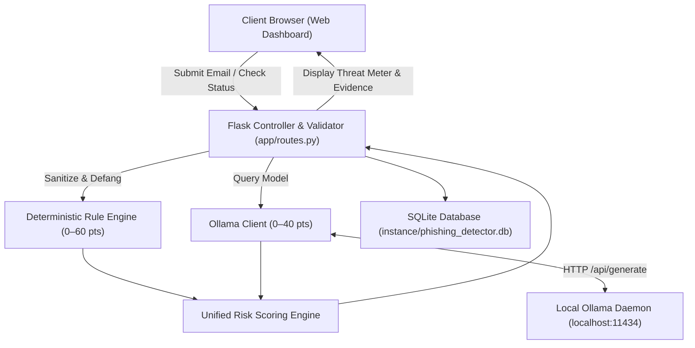

# 🛡️ AI-Powered Phishing Email Detection System

An enterprise-grade, privacy-first cybersecurity web application that detects phishing attacks, credential harvesting, and social engineering in emails. Built with **Python Flask**, **SQLite**, and **Ollama Local AI (`llama3.2:3b`)**.


---

## 📌 Table of Contents
1. [Project Overview](#project-overview)
2. [Problem Definition & Objectives](#problem-definition--objectives)
3. [Key Features](#key-features)
4. [Technology Stack](#technology-stack)
5. [System Architecture](#system-architecture)
6. [Working Flow & Detection Methodology](#working-flow--detection-methodology)
7. [Installation & Setup](#installation--setup)
8. [Ollama Installation & Local AI Setup](#ollama-installation--local-ai-setup)
9. [Running the Application](#running-the-application)
10. [Running the Test Suite](#running-the-test-suite)
11. [Project Folder Structure](#project-folder-structure)
12. [Screenshots & UI Walkthrough](#screenshots--ui-walkthrough)
13. [Limitations & Future Roadmap](#limitations--future-roadmap)
14. [Academic Viva Presentation Guide](#academic-viva-presentation-guide)

---

## 📖 Project Overview

Email phishing remains the initial attack vector in **over 90% of cyber breaches** globally. Modern spear-phishing attacks utilize brand impersonation, urgent psychological coercion, and lookalike domains that bypass static signature filters.

The **AI-Powered Phishing Email Detection System** delivers an on-premise, zero-data-leakage solution designed for security analysts and educational threat triage. By combining a **Deterministic Rule Engine (0–60 points)** with a **Local Large Language Model (0–40 points)** via Ollama, the system generates explainable risk scores (0–100), extracts specific evidence, disarms malicious URLs, and recommends defensive actions without transmitting confidential email contents to third-party cloud APIs.

---

## 🎯 Problem Definition & Objectives

### Problem Definition
1. **Blind Spots in Traditional Gateways:** Rigid keyword filters fail against zero-day URLs and subtle conversational social engineering.
2. **Cloud AI Privacy Hazards:** Commercial cloud APIs (OpenAI, Google, AWS) require sending sensitive email text, attachments, and PII to remote servers, violating strict data protection laws (GDPR, HIPAA).
3. **Lack of Explainability:** Many black-box machine learning models output a probability score without showing *why* an email was flagged or providing actionable remediation steps.

### Objectives
- **Hybrid Threat Detection:** Synthesize 5 deterministic heuristic vectors with local LLM semantic reasoning.
- **Explainable Scoring:** Provide transparent point allocations, evidence snippets, and clear distinction between *Threat Risk Score* and *AI Confidence*.
- **Privacy & Safety:** Run 100% locally with automated link defanging (`hxxp://` and `[.]`) to safeguard analysts.
- **Operational Resilience:** Guarantee continuous operation with graceful rule normalization if the local AI service is unavailable.

---

## ✨ Key Features

- **Cybersecurity Operations Dashboard:** High-contrast dark navy theme with real-time statistics (total scans, phishing detected, safe emails, average risk score).
- **Interactive Email Analysis Form:** Direct inputs for sender, subject line, and message body with 1-click **Sample Email Loaders** for instant demonstrations.
- **5 Core Rule Threat Vectors:**
  - Suspicious URLs (Direct IP hosts, shorteners, risky TLDs, deceptive subdomains, embedded `@` trick).
  - Urgent & Coercive Language (Account suspension threats, 24-hour ultimatums, fake legal summons).
  - Password & OTP Interception (Credential theft, 2FA code harvesting, PIN solicitation).
  - Financial & Payment Fraud (Cryptocurrency wallet addresses, gift cards, invoice redirection).
  - Sender Domain Impersonation (Display name spoofing, brand typosquatting e.g. `paypa1.com`).
- **Local Ollama AI Integration:** Communicates with `llama3.2:3b` using strict structured JSON schema validation.
- **Reproducible Risk Scoring (0–100):**
  - `0–24`: Low (Green)
  - `25–49`: Medium (Yellow)
  - `50–74`: High (Orange)
  - `75–100`: Critical (Red)
- **Real-Time Ollama Connection Monitor:** Interactive status pill verifying daemon availability and model readiness.
- **Scan History & Search:** Search by sender, subject, or findings; filter by risk category and verdict; paginate through past triage records.
- **Single Delete & Clear All Modal:** Safely delete individual records or clear the complete history with confirmation dialogs.
- **Report Exporters:** Export security triage reports as formatted **Plaintext (`.txt`)** or structured **JSON (`.json`)**.
- **College Viva Reference Guide:** Dedicated about page with architecture diagrams, scoring breakdown, and examiner questions and answers.

---

## 💻 Technology Stack

| Layer | Technologies Used | Purpose |
|---|---|---|
| **Backend** | Python 3.11+ / 3.12, Flask 3.1 | REST API, request validation, routing, application controller |
| **Local AI** | Ollama Local API, Llama 3.2 3B | Contextual social engineering reasoning, zero cloud transmission |
| **Database** | SQLite 3 | Embedded, ACID-compliant storage with safe parameterized queries |
| **Frontend** | HTML5, Modern CSS3 Variables, Vanilla JavaScript | Responsive cybersecurity dashboard, animated progress, modal dialogs |
| **Testing** | pytest 9.2, unittest.mock | 37 automated tests covering rules, scoring, mocked AI, and DB |

---

## 🏗️ System Architecture



For full architecture details, see [docs/architecture.md](docs/architecture.md).

---

## 🔄 Working Flow & Detection Methodology

1. **Input Sanitization & URL Defanging:** The email body is inspected for links; all URLs are defanged (e.g. `http://` $\rightarrow$ `hxxp://`, `.` $\rightarrow$ `[.]`) to ensure analyst safety.
2. **Deterministic Heuristic Evaluation:** The 5 threat categories are evaluated. Each category assigns points up to its ceiling. Total rule score is bounded between **0 and 60 points**.
3. **Local AI Model Query:** The email is submitted to Ollama with a strict system prompt instructing it to return valid JSON. If Ollama is offline or times out, the system catches the error and normalizes the rule score without interrupting the user.
4. **Unified Scoring Synthesis:**
   $$\text{Final Risk Score} = \min(100, \text{Rule Score} + \text{AI Score})$$
   *(If AI is offline, $\text{Final Score} = \text{round}\left(\frac{\text{Rule Score}}{60} \times 100\right)$)*
5. **Report Generation & Storage:** The scan record is saved to SQLite using parameterized queries, and rendered in the UI with a circular score meter, indicators breakdown, and defensive recommendations.

For detection flowcharts, see [docs/flowcharts.md](docs/flowcharts.md).

---

## ⚙️ Installation & Setup

### Prerequisites
- **Operating System:** Windows 10/11, macOS, or Linux
- **Python:** Python 3.11 or Python 3.12 installed
- **Git:** Git command-line utility

### 1. Clone the Repository
```bash
git clone https://github.com/your-username/AI-phishing-email-detector.git
cd AI-phishing-email-detector
```

### 2. Create a Virtual Environment
```bash
# Windows
python -m venv venv
venv\Scripts\activate

# macOS / Linux
python3 -m venv venv
source venv/bin/activate
```

### 3. Install Dependencies
```bash
pip install -r requirements.txt
```

### 4. Configure Environment Variables
Copy `.env.example` to `.env`:
```bash
# Windows
copy .env.example .env

# macOS / Linux
cp .env.example .env
```

---

## 🤖 Ollama Installation & Local AI Setup

This project uses **Ollama** to run lightweight open-source models completely locally.

### Step 1: Install Ollama
- **Windows:** Download the Windows installer from [ollama.com/download/windows](https://ollama.com/download/windows). Run the installer.
- **macOS:** Download from [ollama.com/download/mac](https://ollama.com/download/mac) or install via Homebrew: `brew install ollama`.
- **Linux:** Run `curl -fsSL https://ollama.com/install.sh | sh`.

### Step 2: Start the Ollama Service
Open a separate terminal window and run:
```bash
ollama serve
```

### Step 3: Pull the Recommended Model
In your terminal, pull the lightweight `llama3.2:3b` model (approximately 2.0 GB):
```bash
ollama pull llama3.2:3b
```

> **Note:** If your computer has limited RAM, you can also use `llama3.2:1b` (1.3 GB) by updating `OLLAMA_MODEL=llama3.2:1b` in your `.env` file.

> **Offline Safeguard:** If Ollama is not installed or running, **the application will still run perfectly** using its deterministic Rule Engine and clearly display "Ollama: Offline (Rule Fallback)" in the UI!

---

## 🚀 Running the Application

Ensure your virtual environment is active, then launch the Flask server:

```bash
python run.py
```

You will see output similar to:
```text
=================================================================
 🛡️  AI-POWERED PHISHING EMAIL DETECTION SYSTEM
 🌐 Server running at: http://127.0.0.1:5000
 🤖 Ollama configured model: llama3.2:3b
=================================================================
```

Open your browser and navigate to:
```
http://127.0.0.1:5000
```

---

## 🧪 Running the Test Suite

The test suite includes **37 comprehensive tests** covering rule heuristics, score boundaries, mocked Ollama responses, database CRUD operations, and Flask REST endpoints. **No running AI model is required to execute tests.**

```bash
pytest -v
```

Expected output:
```text
============================= test session starts =============================
platform win32 -- Python 3.12.14, pytest-9.2.0, pluggy-1.7.0
rootdir: C:\...\AI-phishing-email-detector
collected 37 items

tests/test_ai.py::test_ollama_check_status_online PASSED                 [  2%]
tests/test_ai.py::test_ollama_check_status_model_missing PASSED          [  5%]
tests/test_ai.py::test_ollama_check_status_offline PASSED                [  8%]
tests/test_ai.py::test_ollama_analyze_email_success PASSED               [ 10%]
tests/test_ai.py::test_ollama_analyze_email_with_markdown_fences PASSED  [ 13%]
tests/test_ai.py::test_ollama_analyze_score_clamping PASSED              [ 16%]
tests/test_ai.py::test_ollama_connection_error_graceful_handling PASSED  [ 18%]
tests/test_ai.py::test_ollama_timeout_graceful_handling PASSED           [ 21%]
tests/test_database.py::test_save_and_retrieve_scan PASSED               [ 24%]
tests/test_database.py::test_search_and_filter_scans PASSED              [ 27%]
tests/test_database.py::test_delete_scan_and_clear_all PASSED            [ 29%]
tests/test_database.py::test_get_statistics PASSED                       [ 32%]
tests/test_database.py::test_get_nonexistent_scan PASSED                 [ 35%]
tests/test_routes.py::test_web_pages_load PASSED                         [ 37%]
tests/test_routes.py::test_api_status PASSED                             [ 40%]
tests/test_routes.py::test_api_sample_emails PASSED                      [ 43%]
tests/test_routes.py::test_api_analyze_suspicious_email PASSED           [ 45%]
tests/test_routes.py::test_api_analyze_safe_email PASSED                 [ 48%]
tests/test_routes.py::test_api_analyze_ollama_offline_graceful_fallback PASSED [ 51%]
tests/test_routes.py::test_api_analyze_validation_empty_body PASSED      [ 54%]
tests/test_routes.py::test_api_analyze_validation_oversized_body PASSED  [ 56%]
tests/test_routes.py::test_history_api_and_exports PASSED                [ 59%]
tests/test_rules.py::test_defang_url PASSED                              [ 62%]
tests/test_rules.py::test_extract_sender_parts PASSED                    [ 64%]
tests/test_rules.py::test_indicator_suspicious_urls PASSED               [ 67%]
tests/test_rules.py::test_indicator_urgency_and_threats PASSED           [ 70%]
tests/test_rules.py::test_indicator_credentials_and_otp PASSED           [ 72%]
tests/test_rules.py::test_indicator_financial_and_payment PASSED         [ 75%]
tests/test_rules.py::test_indicator_sender_spoofing PASSED               [ 78%]
tests/test_rules.py::test_deduplication_prevents_duplicate_counting PASSED [ 81%]
tests/test_rules.py::test_rule_score_maximum_cap PASSED                  [ 83%]
tests/test_rules.py::test_legitimate_clean_email PASSED                  [ 86%]
tests/test_scoring.py::test_risk_category_boundaries PASSED              [ 89%]
tests/test_scoring.py::test_determine_verdict PASSED                     [ 91%]
tests/test_scoring.py::test_hybrid_scoring_calculation PASSED            [ 94%]
tests/test_scoring.py::test_offline_ai_fallback_normalization PASSED     [ 97%]
tests/test_scoring.py::test_confidence_vs_risk_score_independence PASSED [100%]

============================= 37 passed in 5.30s ==============================
```

---

## 📁 Project Folder Structure

```text
AI-phishing-email-detector/
├── app/
│   ├── __init__.py            # Flask application factory & error handlers
│   ├── config.py              # Application configurations & TestConfig
│   ├── database.py            # SQLite database schema, CRUD, parameterized queries
│   ├── routes.py              # Flask route blueprints & REST API controllers
│   ├── rules/
│   │   ├── __init__.py        # Rule engine package exports
│   │   ├── patterns.py        # Regex patterns, keywords, IoC definitions
│   │   └── rule_engine.py     # 5 threat categories, link defanger, deduplication
│   ├── ai/
│   │   ├── __init__.py        # Ollama client package exports
│   │   ├── prompts.py         # System prompt, strict JSON schema template
│   │   └── ollama_client.py   # Ollama API client, markdown stripper, fallback logic
│   └── utils/
│       ├── __init__.py        # Utilities package exports
│       ├── scoring.py         # 0-100 hybrid scoring formula, categories, advisory
│       ├── validators.py      # Input sanitation & character limits
│       ├── exporters.py       # Plaintext TXT & structured JSON export generators
│       └── samples.py         # Pre-configured test emails for 1-click loading
├── templates/
│   ├── base.html              # Core layout, sidebar, header with live Ollama pill
│   ├── index.html             # Home dashboard with statistics & engine health
│   ├── analyze.html           # Email inspection form, progress steps, threat meter
│   ├── history.html           # Scan history, search, category filters, delete modal
│   ├── scan_detail.html       # Individual report detail view with download actions
│   └── about.html             # Viva Voce helper, architecture, examiner Q&A
├── static/
│   ├── css/
│   │   └── style.css          # Dark cybersecurity palette, glowing badges, cards
│   └── js/
│       ├── main.js            # Ollama status polling & toast notifications
│       ├── analyze.js         # Interactive form handling, AJAX submit, UI rendering
│       └── history.js         # History pagination, search debounce, clear-all modal
├── tests/
│   ├── __init__.py
│   ├── conftest.py            # Test database setup & mocked Ollama AI fixtures
│   ├── test_rules.py          # Unit tests for all 5 rule indicators
│   ├── test_scoring.py        # Unit tests for score boundaries & normalizations
│   ├── test_ai.py             # Unit tests for Ollama client & fault recovery
│   ├── test_database.py       # Unit tests for SQLite CRUD & parameterized queries
│   └── test_routes.py         # End-to-end integration tests for web & API
├── docs/
│   ├── architecture.md        # Mermaid diagrams, layer specs, security architecture
│   ├── flowcharts.md          # Working flow, detection flow, fallback flowcharts
│   └── viva_guide.md          # Top 15 college viva defense questions & model answers
├── instance/
│   └── phishing_detector.db   # Local SQLite database (git-ignored)
├── .env.example               # Environment template
├── .gitignore                 # Excludes DB, venv, pycache, .env, sensitive files
├── requirements.txt           # Project dependencies
├── README.md                  # Master project documentation
└── run.py                     # Application startup script
```

---

## 📸 Screenshots & UI Walkthrough

*(To capture actual screenshots for your college project report, run `python run.py`, navigate to `http://127.0.0.1:5000`, and use Windows Snipping Tool or screenshot shortcut).*

### 1. Threat Intelligence Dashboard (`/`)
- Displays real-time aggregate metrics: Total Scans, Phishing Flagged, Verified Safe, and Average Threat Score.
- Dual-engine health card showing Ollama connectivity and active rule indicators.
- Table of recent email scans with quick links to individual reports.

### 2. Email Analysis Interface (`/analyze`)
- Modern form with **1-Click Sample Email Buttons** (Urgent Banking Phishing, 2FA Interception, Crypto Invoice Fraud, Legitimate Meeting).
- Real-time animated 4-stage analysis progress indicator.
- Interactive **Circular Threat Dial (0–100)** color-coded by severity (Low=Green, Medium=Yellow, High=Orange, Critical=Red).
- Matched Evidence section displaying defanged URLs and extracted suspicious phrases.
- AI Reasoning narrative with analytical confidence score.
- Direct download buttons for **Plaintext TXT** and **JSON** security reports.

### 3. Scan History & Search (`/history`)
- Real-time instant search bar across sender, subject line, and findings.
- Dropdown filters for Risk Category and Verdict.
- Delete individual scan records or clear the complete history via confirmation modal.

### 4. Viva Defense & About Project (`/about`)
- Academic reference guide containing architectural diagrams, scoring methodology, and model viva answers.

---

## ⚠️ Limitations & Future Improvements

### Limitations
1. **Attachment Inspection:** Current version inspects text content and URLs; it does not parse binary attachments (`.exe`, `.pdf`, `.xlsm`).
2. **Network DNS Verification:** Lexical analysis is performed on sender headers, but active SPF/DKIM/DMARC DNS queries are omitted to keep the system fully offline.
3. **Hardware Dependency:** Inference speed of the local LLM is dependent on host machine CPU/RAM capacity.

### Future Improvements
- **Attachment Sandbox:** Integration with YARA rules and ClamAV for offline attachment static analysis.
- **DKIM/SPF Resolver:** Optional network module to verify email cryptographic signatures when internet access is enabled.
- **Client Plugins:** Browser extensions (Chrome/Firefox) and email client plugins (Outlook/Thunderbird) for automated background inbox scanning.

---

## 🎓 Academic Viva Presentation Guide

For complete viva defense preparation, open the in-app **About & Viva Guide** page (`/about`) or read [docs/viva_guide.md](docs/viva_guide.md).

Key highlights for examiners:
1. **Explain the Hybrid Value:** Deterministic heuristics guarantee zero false negatives for known IoCs; local LLMs capture novel psychological coercion.
2. **Explain the Privacy Model:** By executing Ollama locally on localhost:11434, no customer emails are shared with third-party cloud vendors.
3. **Differentiate Risk vs. Confidence:** Threat Risk Score indicates *danger* (0–100); AI Confidence indicates *model certainty* (0–100%).

---

## 📄 License & Attribution

Developed as an academic college project demonstrating AI-assisted cybersecurity engineering. Free to use and extend for academic and research purposes.
