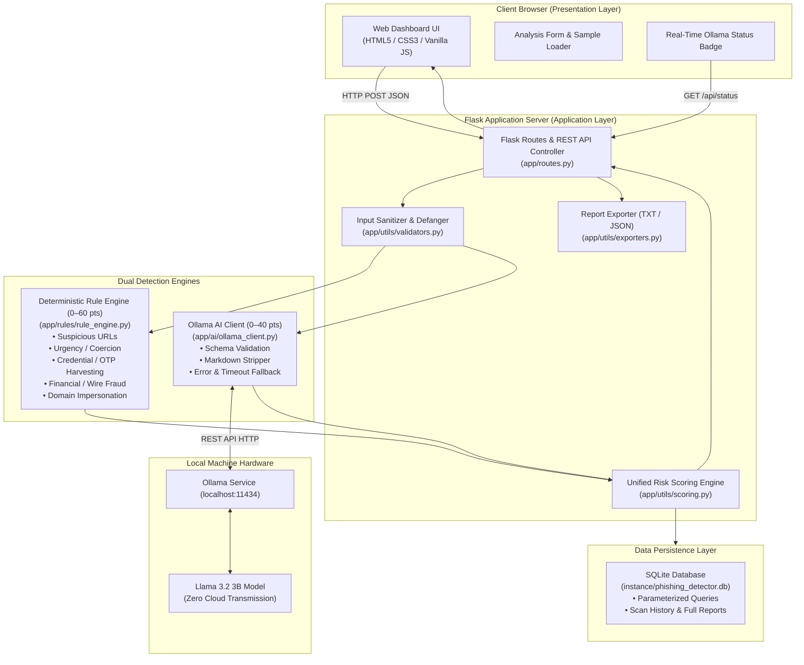

# System Architecture & Technical Specifications

## 1. Architectural Overview

The **AI-Powered Phishing Email Detection System** utilizes a **two-tier hybrid threat detection model** combining:
1. **Deterministic Rule Engine (Layer 1)**: Heuristic regex and string pattern recognition for instant, zero-latency detection of known indicators of compromise (IoCs).
2. **Local Neural Language Model (Layer 2)**: On-premise Large Language Model (`llama3.2:3b`) running via Ollama for semantic intent analysis and social engineering triage.

---

## 2. Component Breakdown

| Module | Primary File | Responsibility |
|---|---|---|
| **Web Presentation** | `templates/*.html`, `static/css/style.css`, `static/js/*.js` | Dark cybersecurity themed dashboard, animated progress states, circular threat gauge, sample loader, and search filters. |
| **Routing & API** | `app/routes.py` | Exposes REST endpoints (`/api/analyze`, `/api/status`, `/api/history`, etc.) and renders server-side Jinja templates. |
| **Rule Engine** | `app/rules/rule_engine.py`, `app/rules/patterns.py` | Evaluates 5 threat categories, disarms malicious URLs (defanging), extracts evidence snippets, and caps score at 60. |
| **AI Integration** | `app/ai/ollama_client.py`, `app/ai/prompts.py` | Communicates with Ollama daemon via local socket/HTTP, validates strict JSON schema, clamps score to 40, and handles offline states. |
| **Scoring Engine** | `app/utils/scoring.py` | Combines rule and AI scores, normalizes rule scores when AI is offline, calculates risk categories, and distinguishes risk from confidence. |
| **Database** | `app/database.py` | SQLite persistence using parameterized queries to prevent SQL injection. Manages history search, filtering, and aggregation. |
| **Exporters** | `app/utils/exporters.py` | Generates structured JSON and professional Plaintext Cybersecurity Incident Triage Reports. |

---

## 3. Privacy & Security Model

1. **Zero External Data Leakage**: Emails submitted to the system are processed entirely on localhost. No data is transmitted to OpenAI, Anthropic, Google, or any cloud LLM provider.
2. **Defensive Link Disarming**: URLs found in suspicious emails are defanged (e.g. `hxxp://` and `[.]`) in UI displays and exported reports to prevent accidental clicks.
3. **Injection Prevention**: Safe parameterized SQL queries (`?` placeholders) and Jinja2 template auto-escaping prevent SQLi and XSS.
4. **Input Boundary Limits**: Strict character length validation (max 100,000 characters for body) protects against denial-of-service via memory exhaustion.
