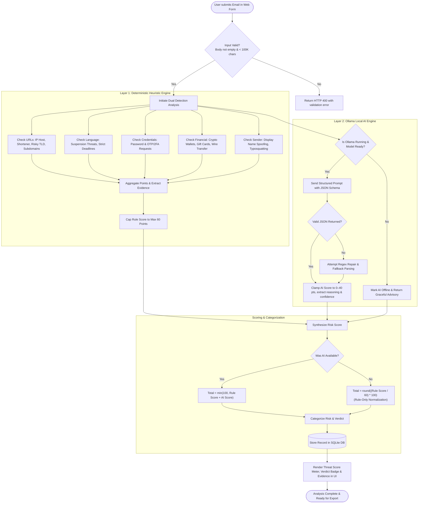
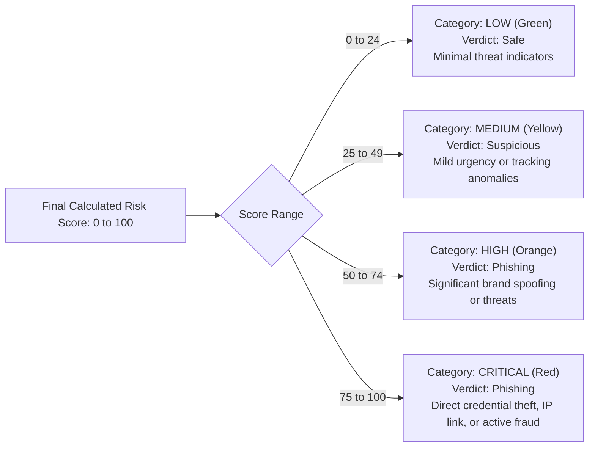
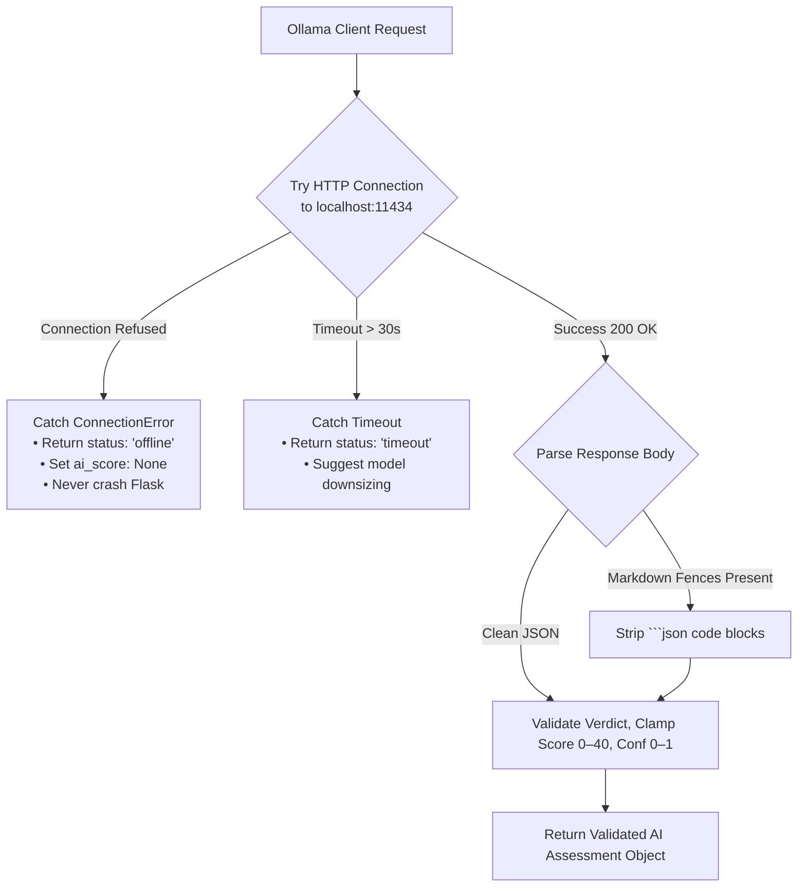

# Threat Detection Flowcharts & Execution Logic

## 1. End-to-End Analysis Working Flow

---

## 2. Risk Categorization & Verdict Determination

---

## 3. Ollama Fallback & Fault Tolerance Flow

